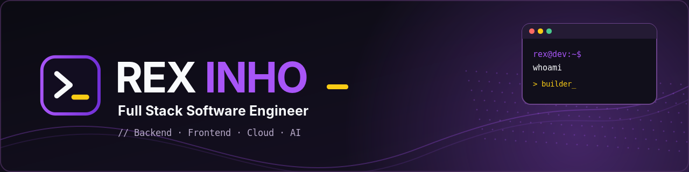

<div align="center">
  
</div>

# Hi, I'm Rex 👋

**Full Stack Software Engineer** · Cloud & AI Enthusiast · Founder of [Bitsxer](https://bitsxer.com)

```text
rex@github:~$ whoami
> Software engineer building scalable applications,
  exploring AI, and turning ideas into digital products.
```

I'm a software engineer with **10+ years of experience** building applications across backend, frontend, databases, and cloud infrastructure. I enjoy solving real-world problems, designing maintainable systems, and learning continuously.

### > Tech stack

| Area | Technologies |
| --- | --- |
| **Languages** | C#, Python, TypeScript, JavaScript, SQL |
| **Frontend** | React, Next.js, Angular, Blazor, HTML, CSS |
| **Backend** | .NET, ASP.NET Core, FastAPI, Django, Node.js, NestJS |
| **Cloud & DevOps** | AWS, Terraform, Docker, Linux, Nginx |
| **Databases** | PostgreSQL, SQL Server, MySQL, SQLite, DynamoDB |
| **Architecture** | Clean Architecture, CQRS, SOLID, REST APIs, Serverless |

### > Currently exploring

- Building full-stack applications and SaaS products.
- Strengthening frontend expertise alongside backend and architecture.
- Exploring AI-assisted development and intelligent automation.
- Sharing practical lessons from real-world engineering.

### > Engineering mindset

```text
Think before coding.
Build with purpose.
Keep it simple.
Measure what matters.
Never stop learning.
```

### > Beyond the code

I'm the founder of **[Bitsxer](https://bitsxer.com)**, focused on turning software and technology into useful digital solutions.

### > Connect

- **GitHub:** [@rexinhodev](https://github.com/rexinhodev)
- **Website:** rexinho.dev *(coming soon)*
- **Company:** [Bitsxer](https://bitsxer.com)

---

```text
rex@github:~$ echo "Keep building."
Keep building.
```
